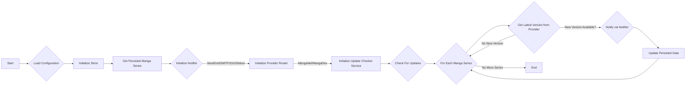

<h3 align="center"></h3>

# Manga updates

I built this tool to track manga series I read and send an email when a new chapter drops. Everything runs from a GitHub repository on a scheduled GitHub Actions workflow, or locally from the terminal.

## How to get started

The `example` directory shows how to wire `manga-updates` into a data repository with a scheduled GitHub Actions workflow.

### Directory structure

```
.
├── .github
│   └── workflows
│       └── send_email.yaml
└── data
    └── <manga-title>
        └── data.json
```

- `.github/workflows/send_email.yaml` runs the `manga-updates` binary on a schedule, checks each tracked series for new chapters, sends email notifications, and commits updated `data.json` files back to the repository.
- `data/<manga-title>/data.json` stores the state and chapter history for one manga series.

### The `data.json` file

Each tracked series has its own `data.json` file:

```json
{
  "name": "Unexpected Accident",
  "shouldNotify": true,
  "lastUpdate": null,
  "slug": "unexpected-accident",
  "status": "",
  "latestChapter": null,
  "source": "manganel",
  "chapters": []
}
```

- `name` is the display title of the manga.
- `shouldNotify` controls whether new chapters trigger an email notification.
- `lastUpdate` records when the series last updated. The binary updates this field.
- `slug` identifies the series on the source site, such as `unexpected-accident` from `https://manganel.me/manga/unexpected-accident`.
- `status` tracks whether the series is `ongoing` or `complete`. The binary updates this field.
- `source` selects the provider. Supported values are `manganel` and `mangadex`.
- `chapters` holds the synced chapter list. The binary updates this field.

### Tracking a new series

Copy `data/title.json.tpl` into a new folder under `data/` and fill in `name`, `source`, and `slug`. You can also run `manga-cli add <url>` to generate the file from a MangaNel or MangaDex URL.

#### Finding the `slug`

- **MangaNel.** Take the last path segment of the series URL. For `https://manganel.me/manga/one-piece`, the slug is `one-piece`.
- **MangaDex.** Take the UUID from the title URL. For `https://mangadex.org/title/a77742b6-363c-4310-9eca-2b7992395b3a/one-piece`, the slug is `a77742b6-363c-4310-9eca-2b7992395b3a`.

The remaining fields in `data.json` are populated on the first sync run.

### Workflow configuration

Set these environment variables in `send_email.yaml`:

- `SMTP2GO_API_KEY` holds your SMTP2GO API key. Store it as a GitHub Actions secret.
- `SMTP2GO_TEMPLATE_ID` sets an optional SMTP2GO template ID.
- `NOTIFICATION_EMAIL_RECIPIENT` sets the destination email address.
- `NOTIFICATION_EMAIL_SENDER` sets the sender email address.
- `SERIES_DATAFOLDER` points to the directory containing your `data.json` files, such as `./data`.

### How a run works

1. GitHub Actions triggers the workflow on a cron schedule.
2. The job checks out the repository and downloads the latest `manga-updates` release binary.
3. The binary loads every `data.json` file under `SERIES_DATAFOLDER` and queries MangaNel or MangaDex for new chapters.
4. When a series has new chapters and `shouldNotify` is `true`, the notifier sends an email for the newest chapter.
5. The binary writes the updated chapter list to disk, and the workflow commits and pushes any changed `data.json` files.

## Architecture

### Providers

- **MangaNel.** Queries the MangaNel GraphQL API. It reads the `mhub_access` session cookie from a plain HTTP request to `manganel.me` and falls back to headless Chrome via `chromedp` only if the HTTP response omits the cookie.
- **MangaDex.** Queries the MangaDex REST API through `mangodex`.

### Notifiers

- **SendGrid.** Sends transactional emails through the SendGrid API.
- **SMTP2GO.** Sends transactional emails through the SMTP2GO API.
- **Standard output.** Logs notifications to stdout when no email API key is configured.

### Store

`fileStore` reads and writes `data.json` files on disk, defaulting to `$HOME/repos/manga-updates/data`.

### Program flow



## Local development

### 1. Clone the repository

```bash
git clone https://github.com/ivan-penchev/manga-updates.git
cd manga-updates
```

### 2. Configure environment variables

Copy the template file and fill in your local settings:

```sh
cp ./config/local.tpl ./config/local.env
```

### 3. Optional remote headless Chrome

MangaNel requests fetch the `mhub_access` cookie over HTTP by default. If you want to test the browser fallback against a remote Chrome instance, run `browserless/chromium` in Docker and set `REMOTE_CHROME_URL=ws://127.0.0.1:3000`:

```bash
docker run -d -p 3000:3000 ghcr.io/browserless/chromium
```

### 4. Run the binary

Source `config/local.env` and run `cmd/manga-updates/main.go`:

```bash
source config/local.env
go run cmd/manga-updates/main.go
```

Or export the variables directly in your shell:

```bash
export NOTIFICATION_EMAIL_RECIPIENT="your_email@example.com"
export NOTIFICATION_EMAIL_SENDER="sender@example.com"
export SERIES_DATAFOLDER="./data"
go run cmd/manga-updates/main.go
```